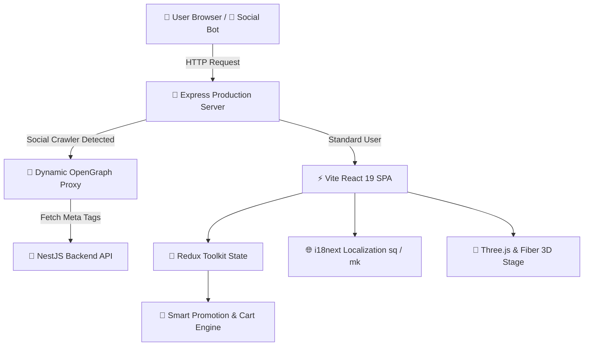

<div align="center">

  # ✨ Lemea Fragrance (Lemea Flagrance) ✨
  ### *The Essence of Luxury — Premium Fragrances & Oriental Perfumes*

  [](https://react.dev/)
  [](https://vitejs.dev/)
  [](https://tailwindcss.com/)
  [](https://redux-toolkit.js.org/)
  [](https://threejs.org/)
  [](https://www.i18next.com/)
  [](https://railway.app/)

  <br />

  [🌐 Live Storefront](https://lemeaflagrance.shop/) • [📸 Instagram](https://www.instagram.com/lemea.flagrance) • [📦 Report Bug](https://github.com/ermalkamishi/Lemea-Flagrance-Front/issues)

</div>

---

## 🌟 Overview

**Lemea Fragrance** is a modern, high-performance e-commerce platform dedicated to curating and delivering authentic Arabian and designer perfumes (such as *Lattafa*, *French Avenue*, and *Maison Alhambra*) across **North Macedonia** and **Kosovo**.

Crafted with a sleek, luxury aesthetic, this web application combines the blazing speed of **Vite + React 19** with sophisticated interactive touches powered by **Three.js**, **Framer Motion**, and **Ant Design**. The application features an intelligent promotional engine, bilingual localization, dynamic OpenGraph bot proxying for rich social sharing, and an administrative control panel for store operations.

---

## ✨ Key Highlights

- 🌹 **Curated Perfume Showcase**: High-res product galleries, scent notes breakdown, interactive 3D visualizers, and real-time inventory tracking.
- 🎁 **Smart Dynamic Promotion Engine**:
  - Automated combo rules (e.g., *Perfume + Free Body Mist*, *3 Body Mists for 999 Den*).
  - Time-limited flash sale banners and real-time cart recalculations powered by Redux selectors.
- 📱 **Social Crawler Smart Proxy**:
  - Embedded Node.js Express server (`server.js`) intercepts social crawlers (Facebook, WhatsApp, Viber, Twitter, Telegram, LinkedIn, Discord, Googlebot).
  - Pre-fetches dynamic OpenGraph previews from the NestJS backend, ensuring rich product cards when links are shared on chat apps.
- 🌍 **Bilingual & Localized (i18n)**:
  - Seamless instant language switcher between **Shqip (Albanian)** and **Македонски (Macedonian)**.
  - Native currency support (**MKD / Denar**) and Cash on Delivery (COD) tailored for local couriers.
- 🛒 **Frictionless Shopping Experience**:
  - Persistent shopping bag with local storage sync.
  - Express checkout optimized for regional addresses and phone formats.
  - Customer review and rating submission pipeline.
- 👑 **Administrative Control Center**:
  - Complete Product CRUD with drag-and-drop image uploads.
  - Live order management with status flows (*Në pritje*, *Në proces*, *Kryer*, *Anuluar*).
  - Revenue, inventory metrics, and quick product toggles.

---

## 🛠️ Architecture & Tech Stack



### 💻 Technologies

| Category | Tools & Libraries |
| :--- | :--- |
| **Core Framework** | [React 19](https://react.dev/) + [Vite 8](https://vitejs.dev/) |
| **Styling & UI** | [Tailwind CSS v4](https://tailwindcss.com/), [Ant Design 6](https://ant.design/), [Ant Design Icons](https://ant.design/components/icon) |
| **State Management** | [Redux Toolkit](https://redux-toolkit.js.org/), [React-Redux](https://react-redux.js.org/) |
| **3D & Motion** | [Three.js](https://threejs.org/), [@react-three/fiber](https://docs.pmnd.rs/react-three-fiber), [@react-three/drei](https://github.com/pmndrs/drei), [Framer Motion](https://www.framer.com/motion/) |
| **Internationalization** | [i18next](https://www.i18next.com/), [react-i18next](https://react.i18next.com/) |
| **Routing & SEO** | [React Router v7](https://reactrouter.com/), [react-helmet-async](https://github.com/staylor/react-helmet-async) |
| **Server & Middleware** | [Express 5](https://expressjs.com/), Node.js fetch proxy, [Railway](https://railway.app/) |

---

## 📁 Project Structure

```text
lemea-flagrance/
├── public/                 # Static assets & icons
├── src/
│   ├── assets/             # Brand logos, icons, and hero photography
│   ├── components/         # Reusable UI widgets & dynamic promo banners
│   │   ├── ComboPromoBanner.jsx
│   │   ├── HomePromoBanner.jsx
│   │   ├── PromoBanner.jsx
│   │   └── ProtectedRoute.jsx
│   ├── Header-Footer/      # Global navigation header & responsive footer
│   ├── pages/              # Routed pages
│   │   ├── Home.jsx            # Hero carousel, featured perfumes, reviews
│   │   ├── Products.jsx        # Catalog, filtering, search & sorting
│   │   ├── ProductDetailed.jsx # Rich product showcase, details & notes
│   │   ├── Cart.jsx            # Cart management & promotion breakdown
│   │   ├── Checkout.jsx        # Delivery details & COD checkout
│   │   ├── AdminDashboard.jsx  # Store management & order dashboard
│   │   └── ...
│   ├── redux/              # Redux slices (cart, products, auth, orders)
│   ├── utils/              # Image resolution, API helpers, formatters
│   ├── i18n.js             # Bilingual dictionary (sq / mk)
│   ├── App.jsx             # Top-level routing & layout shell
│   └── main.jsx            # React root mount
├── server.js               # Express SSR Bot-Proxy & static production server
├── .env.example            # Sample environment variables
├── package.json            # Dependencies & scripts
└── vite.config.js          # Vite build configuration
```

---

## 🚀 Getting Started

### Prerequisites

- **Node.js** (v18.x or v20.x recommended)
- **npm** or **yarn** / **pnpm**

### 1. Clone the Repository

```bash
git clone https://github.com/ermalkamishi/Lemea-Flagrance-Front.git
cd lemea-flagrance
```

### 2. Configure Environment Variables

Duplicate `.env.example` into `.env`:

```bash
cp .env.example .env
```

Define the backend API target:

```env
# Backend API URL
VITE_API_URL=https://lemea-flagrance-back-production.up.railway.app
```

### 3. Install Dependencies

```bash
npm install
```

### 4. Start Local Development

Run the Vite development server with Hot Module Replacement (HMR):

```bash
npm run dev
```

Visit `http://localhost:5173` in your browser.

---

## 🚢 Production & Deployment

### Build the Application

Compile optimized static client assets to `dist/`:

```bash
npm run build
```

### Run the Express Bot-Proxy Server

Run the production server with social media crawler interception:

```bash
npm start
```

The server listens on `0.0.0.0:3000` (or `PORT` provided by Railway/hosting provider).

---

## 🤖 Dynamic Social Crawler Interception

When links (e.g. `https://lemeaflagrance.shop/produktet/123`) are shared on **WhatsApp, Facebook, Viber, or Telegram**, the built-in middleware in `server.js` automatically detects crawler user-agents:

```javascript
// server.js
const BOT_USER_AGENTS =
  /facebookexternalhit|viber|whatsapp|twitterbot|telegrambot|googlebot|bingbot|linkedinbot|slackbot|discordbot/i;
```

Instead of returning an empty SPA shell, it forwards the crawler request to the backend API, delivering server-rendered OpenGraph tags with the exact perfume image, title, and fragrance description.

---

## 🛡️ License & Acknowledgements

Created with ❤️ for **Lemea Fragrance**.  
All rights reserved. Designed to deliver an unforgettable olfactory journey.

